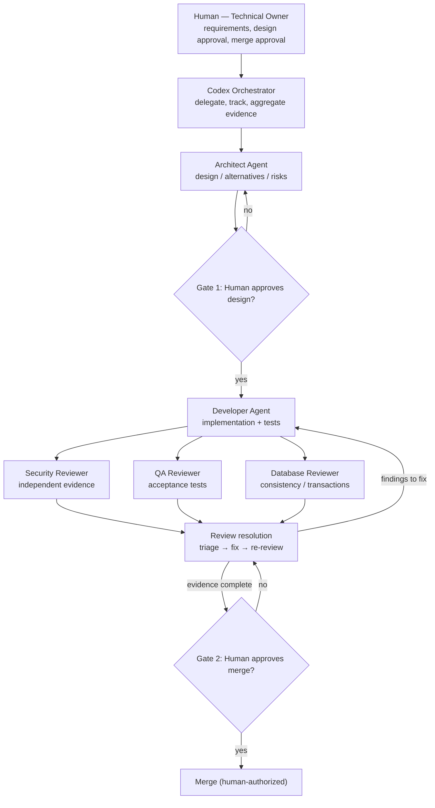

# AI Team — relationships and approval flow

## Organization (Mermaid)

## Communication boundaries
- Human → Orchestrator: original requirements and approvals. Human retains decision power.
- Orchestrator → Architect: request design review based on inspected codebase.
- Architect → Human: options, assumptions, decision record, risks, acceptance criteria.
- Human → Developer (via Orchestrator): explicit approved scope, tests, constraints.
- Developer → Reviewers: code diff and test evidence; provide original requirement independently.
- Reviewers → Orchestrator: independently verified findings; never treat developer self-review as evidence.
- Orchestrator → Human: disagreement matrix, evidence, unverified items, recommendation only.
- Human → GitHub: explicit merge approval; agent approval is not sufficient.

## Escalation
Any architecture change, third-party dependency, unsafe migration, deployment, secret handling, or scope expansion stops for a human decision.

## Agent independence limitations
The model family can share blind spots. Require executable tests, CI, reproducible findings and human review. Profiles alone do not enforce file permissions, execution order, or automatic delegation.

## Practical team size
Small CRUD: architect + developer + QA.
Sensitive authentication: add security reviewer.
Transactional order changes: add database reviewer.
